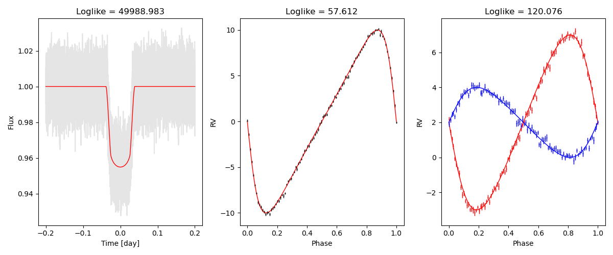
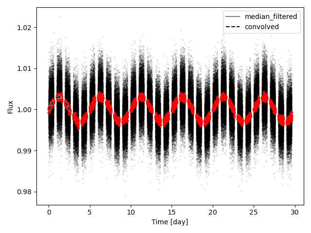
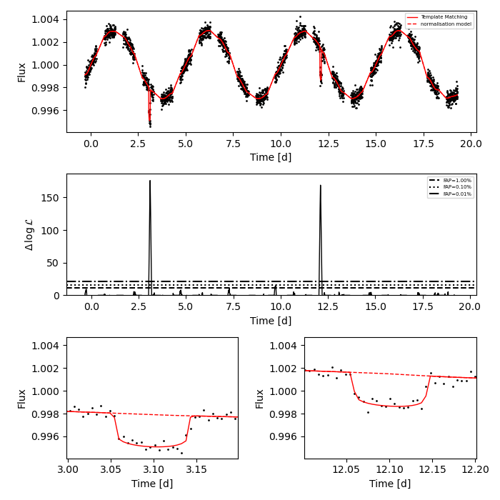

# BRUCE

BRUCE is a Python and C toolkit for modelling exoplanet transits and eclipsing binaries, analysing TESS and ground-based photometry, resolving ambiguous orbital periods, and producing astronomical plots and animations. NumPy C extensions and optional OpenMP parallelism support the numerical calculations.


## Installation

Use Python 3.9 or later, a C99 compiler and NumPy headers. From a source checkout:

```bash
python -m pip install numpy setuptools wheel
python -m pip install -e '.[analysis]'
# Add interactive Qt tools if required:
python -m pip install -e '.[analysis,gui]'
```

The base installation supplies NumPy, SciPy and Astropy. The `analysis` extra adds fitting, plotting, archive and observing-planning dependencies; `gui` adds PyQt5 and pyqtgraph. Archive queries require network access. Some command-line workflows also use external programmes or environment-specific resources; see their `--help` and source before running them on a new installation.

On macOS, OpenMP is enabled when libomp is found under `/opt/homebrew/opt/libomp` or `/usr/local/opt/libomp`. Set `BRUCE_LIBOMP_PREFIX` for another location. GCC builds enable OpenMP by default. To build without OpenMP:

```bash
BRUCE_OPENMP=0 python -m pip install -e '.[analysis]'
```

Use `BRUCE_OPENMP=1` to require OpenMP. Set its thread count before starting Python, particularly when combining model evaluation with multiprocessing:

```bash
export OMP_NUM_THREADS=1
```

## What is available?

| Module | Capabilities |
| --- | --- |
| `bruce.binarystar` | Transit/eclipse light curves (`lc`), primary and double-lined radial velocities (`rv1`, `rv2`), circular transit durations, and stellar densities. |
| `bruce.binarystar.ttv` | Chopping TTV models, companion-period scans, resonance searches, synodic-period conversions, branch diagnostics, and TTV plots. |
| `bruce.data` | Fixed and adaptive binning, time-based median/convolution filters, night segmentation, flux/magnitude conversions, phase folding, timestamp proximity checks, and detrending. |
| `bruce.data.nasa_archive` | NASA Exoplanet Archive caching, SIMBAD queries, TOI/CTOI tables, TIC information and Gaia queries. Some helpers retain installation-specific paths. |
| `bruce.data.ngtsfit` | `NGTSFIT_DATA`: load NGTS FITS products and display action summaries with Matplotlib or pyqtgraph. |
| `bruce.template_match` | Transit-template searches, matched-filter signal-to-noise estimates, false-alarm thresholds and phase-dispersion period searches. |
| `bruce.sampler` | Priors, Gaussian likelihoods, orbital/limb-darkening transformations, emcee sampling, posterior reports, corner plots, BIC and LaTeX formatting. |
| `bruce.ambiguous_period` | TESS retrieval, photometric time-series management, individual-event fitting, period-alias generation, probability calculations and observing plans. |
| `bruce.empirical_relations` | Planet mass–radius estimates and the implemented inverse relation. |
| `bruce.visual` | Orbit animation with optional GIF export. |

See the [Sphinx API reference](docs/index.rst) for the documented core functions and their arguments. Existing spellings such as `phase_disperison`, `intilise_and_run_sampler` and `calcualte_aliases` remain part of the API.

## Model a transit or radial velocities

```python
import numpy as np
import bruce

# Times and periods are in days; angles are in radians.
time = np.linspace(-0.15, 0.15, 1000, dtype=np.float64)
flux_model = bruce.binarystar.lc(
    time, t_zero=0.0, period=3.0, radius_1=0.1, k=0.1,
    incl=np.pi / 2, e=0.0, w=np.pi / 2,
    c=0.7, alpha=0.4, cadence=2 / 1440, noversample=11,
)
rv_model = bruce.binarystar.rv1(
    time, period=3.0, K1=10.0, V0=0.0,
)
rv_primary, rv_secondary = bruce.binarystar.rv2(
    time, period=3.0, K1=10.0, K2=20.0,
)
```

`radius_1` is the stellar radius divided by the orbital semi-major axis; `k` is the companion-to-star radius ratio. `cadence` is in days. For `cadence > 0`, `noversample` must be an odd integer of at least 3 (default 11); invalid counts raise `ValueError`. Use `cadence=0` for instantaneous evaluation. RV amplitudes and systemic velocity must share a unit. `lc`, `rv1` and `rv2` return models unless observations and their uncertainties are supplied, in which case they return the extension's likelihood statistic. **The existing C wrappers return negative log likelihood, whereas `bruce.sampler.loglike` returns log likelihood.** This convention is retained for compatibility: check the sign required by your optimiser or posterior. `offset=1` includes the variance-dependent logarithmic term; additive Gaussian constants are omitted.

`accurate_tp=1` finds the eclipse epoch by minimising projected separation;
`accurate_tp=0` uses the edge-on conjunction approximation
(`nu_zero = pi/2 - w`). Both modes honour `t_zero` and solve the elliptic
Kepler equation. The C anomaly routines return angles in `[0, 2π)` and
return `NaN` for invalid eccentricities or non-positive periods. The former
`accurate_tp=0` behaviour ignored `t_zero`; models computed with that setting
can therefore change after this correction.

`ld_law=2` selects the power-2 law. `ld_law=-2` models a single transit around the trial epoch. Use the sampler transforms `ca_to_h1h2` and `h1h2_to_ca` when fitting decorrelated limb-darkening parameters. `transit_width` assumes a circular orbit; `stellar_density` returns solar units.



## Process a light curve

```python
# time and flux must be equally sized, sorted one-dimensional arrays.
binned_time, binned_flux, binned_error, counts = bruce.data.bin_data(
    time, flux_model, bin_size=10 / 1440,
)
trend = bruce.data.median_filter(time, flux_model, bin_size=0.2)
trend = bruce.data.convolve_1d(time, trend, bin_size=0.1)
phase = bruce.data.phase_times(time, epoch=0.0, period=3.0)
nights = bruce.data.find_nights_from_data(time, dx_lim=0.5)
```

Fixed binning returns **four** arrays, including counts. Adaptive binning returns bin start times, end times, fluxes, errors and counts. `flatten_data_with_function` returns a trend evaluated at the input times using a polynomial, smoothing spline or Savitzky–Golay filter; divide the observations by the trend to normalise them. Choose the filter scale with the transit duration in mind.



## Search for additional transits

```python
# Replace these synthetic arrays with observed photometry.
flux = flux_model.copy()
flux_err = np.full(time.size, 0.001)
normalisation = np.ones_like(flux)
trial_epochs, delta_statistic = bruce.template_match.template_match_lightcurve(
    time, flux, flux_err, normalisation,
    period=3.0, radius_1=0.1, k=0.1, incl=np.pi / 2,
)
from scipy.signal import find_peaks
probabilities, thresholds = (
    bruce.template_match.get_delta_loglike_height_from_fap(
        p_value=[0.01, 0.001, 0.0001], df=3,
    )
)
peaks, properties = find_peaks(delta_statistic, height=thresholds[-1])
```

The C search accumulates twice the log-likelihood improvement over the supplied normalisation model. Positive values favour the transit template. The chi-square thresholds depend on the assumed degrees of freedom; they do not establish a search-wide false-alarm probability automatically. `template_match_snr` returns `(trial_epochs, z, statistic, rho2)` for a single template.

For a period search, use the current six-data-array interface (the historical spelling is preserved):

```python
periods, dispersion, unused_statistic = bruce.template_match.phase_disperison(
    trial_epochs, peaks, time, flux, flux_err,
    periods=np.linspace(1, 30, 10000),
)
```

The second statistic array is currently zero-filled because its C calculation is disabled; use the dispersion output for this search.



## TESS, fitting and period aliases

`bruce.ambiguous_period.download_tess_data` retrieves TESS photometry; its options select sectors, SPOC/FFI products, download location and binning. Inspect its signature before a large download. `photometry_time_series` provides loading/writing, normalisation, transit fitting and plotting. `mono_event` fits an individual event at a fixed trial period. `ambiguous_period` combines events and coverage to investigate aliases, include stellar-density constraints, plot solutions and plan follow-up observations. Runnable examples and command-line guides are in [docs](docs/index.rst).

`bruce.sampler` supplies uniform, normal and bounded-normal priors, eccentricity and limb-darkening transforms, `intilise_and_run_sampler`, posterior summaries and corner plots. Its Python likelihood sums finite pointwise contributions and retains the historical policy of ignoring non-finite contributions; validate and mask observations explicitly before scientific fitting.

## TTVs, empirical relations and animations

The TTV helpers exposed by `bruce.binarystar` include `chopping_model`, `scan_companion_period`, `nearest_resonances`, `synodic_period`, `synodic_to_periods`, `plot_single_epoch`, `stroboscopic_ttv_plot`, `plot_period_scan` and `plot_ttv_model`. Additional branch and orbital-geometry helpers are available from `bruce.binarystar.ttv`.

`bruce.empirical_relations.mass_radius` accepts Earth or Jupiter mass and radius units. `radius_to_mass` takes Earth radii and returns Earth masses using the implemented piecewise branches. These empirical estimates are model-dependent; the inverse is not globally unique across all physical regimes.

```python
animation = bruce.visual.animate_orbit(
    [dict(t_zero=0.0, period=3.0, incl=np.pi / 2,
          e=0.0, w=np.pi / 2, radius_1=0.1, k=0.1)],
    t=np.linspace(-0.2, 0.2, 100),
    save_gif=True, gif_path="orbit.gif",
)
```

## Command-line tools

| Command | Purpose |
| --- | --- |
| `monofind` | Search TESS photometry for transit candidates and produce diagnostic products. |
| `spocfit` | Interactive fitting of SPOC light curves. |
| `tesstpf` | Interactive TESS target-pixel inspection and extraction. |
| `predict` | Predict transits and plot observing visibility. |
| `ngtsstack` | Normalise and combine NGTS tables. |
| `j2d` | Convert a Julian Date to a calendar date. |
| `tj2d` | Convert a TESS time (JD − 2457000) to a calendar date. |

The old `lcmatch` console entry referenced a missing module and has been removed. Its archived implementation remains under `src/utils/backup/`; use `bruce.template_match` for current searches. GUI tools require a graphical session and the `gui` extra.


## Scientific background

The Keplerian solutions and radial-velocity calculations draw upon the source code of [ellc](https://github.com/pmaxted/ellc) as described here: [Maxted (2016)](https://www.aanda.org/articles/aa/full/2016/07/aa28579-16/aa28579-16.html). The transit implementation uses the analytical qpower2 model [Maxted and Gill 2019](https://ui.adsabs.harvard.edu/abs/2019A%26A...622A..33M/abstract).

## Licence

BRUCE is open-source software licensed under the **GNU GPL version 3 or later**
(`GPL-3.0-or-later`); see [LICENSE](LICENSE). Its orbital modelling core includes
routines adapted from Pierre Maxted's GPL-licensed `ellc` code. Attribution and
modification details are provided in [NOTICE.md](NOTICE.md).

For versioned GitHub releases and optional PyPI publication, see [RELEASING.md](RELEASING.md).

## Documentation

The Sphinx user guide in [docs/](docs/index.rst) includes GitHub installation, runnable transit and RV examples, template matching, an orbit GIF and API references. To build and view it locally:

```bash
python -m pip install -r docs/requirements.txt
python -m sphinx -W --keep-going -b html docs docs/_build/html
python -m http.server 8000 --directory docs/_build/html
```

Open <http://localhost:8000>. BRUCE must be installed to run the example scripts; the HTML build itself reads the committed documentation and images. See [the build guide](docs/building.rst) to regenerate examples and API signatures.

## Contributing and support

See [CONTRIBUTING.md](CONTRIBUTING.md) for contribution guidelines, test commands and how to report issues or request help.
