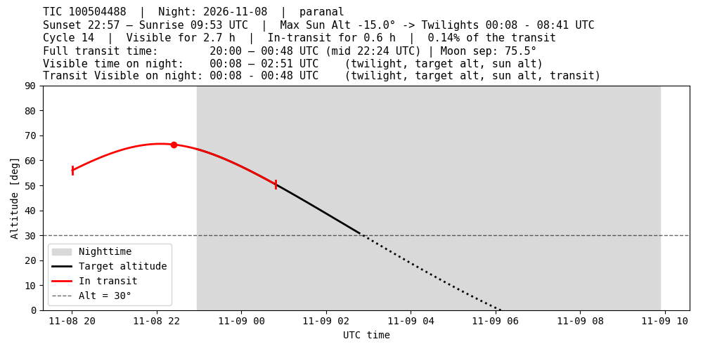

predict: plan transit follow-up
===============================

``predict`` combines a target's TIC coordinates, an ephemeris and an observing
site to identify transit windows that overlap observable nighttime. It prints
an event table, saves it as FITS and writes altitude-versus-time plots for the
selected events.

Example at Paranal
------------------

.. code-block:: bash

   predict 100504488 \
     --t_zero 2461348.8137584263 \
     --period 0.33 \
     --width 0.2 \
     --start 2026-11-04 \
     --end 2026-11-30 \
     --observatory paranal

``--width`` is required by the current command. Here **0.2 days** (4.8 hours)
matches the total transit duration in the supplied output, with ingress and
egress at mid-transit minus/plus 0.1 days. The period and duration above
illustrate the planner; supply your measured ephemeris and duration for a
scientific target.

.. list-table::
   :header-rows: 1
   :widths: 30 70

   * - Argument
     - Meaning
   * - ``tic_id``
     - Positional TIC identifier; coordinates are retrieved from MAST.
   * - ``--t_zero``
     - Reference mid-transit epoch as a full Julian Date.
   * - ``--period``
     - Orbital period in days.
   * - ``--width``
     - Full transit duration in days.
   * - ``--start``, ``--end``
     - Search interval as dates understood by Astropy Time. Defaults to now
       through 20 days later if omitted.
   * - ``--observatory``
     - Astropy site-registry name; default ``Paranal``.

The planner constructs its event and visibility times in **UTC JD**. Convert
an ephemeris in another scale/convention, such as BJD_TDB, before relying on
precise contact times. The current planner does not propagate ephemeris
uncertainties.

Event plot
----------

   Supplied example for the night of 8 November 2026. The black curve traces
   target altitude, the red section marks the transit and the grey background
   indicates nighttime. The horizontal dashed line is the 30-degree target
   altitude threshold. Use the overlap of transit, darkness and target
   visibility to plan coverage.

The printed ``frac_in_transit`` column is a **fraction from 0 to 1**: a value
of 0.14 means about 14 per cent coverage. Interpret this column directly when
assessing coverage; the current plot title appends a percent sign to the
unscaled fraction.

Printed output and saved FITS table
-----------------------------------

The following is the supplied console output, retained as an example rather
than regenerated during the documentation build. Astropy abbreviates the
middle columns with ``...``; the saved FITS table retains all columns.

.. literalinclude:: predict-output.txt
   :language: text

:download:`Download the example console output <predict-output.txt>`.

The command writes the table to the current working directory as:

.. code-block:: text

   TIC-100504488_paranal_2026-11-04_to_2026-11-30.fits

It overwrites a table with the same filename. Read the complete results with:

.. code-block:: python

   from astropy.table import Table

   events = Table.read(
       'TIC-100504488_paranal_2026-11-04_to_2026-11-30.fits')
   print(events['night', 'transit_center_jd', 'in_transit_for', 'frac_in_transit'])

Each event plot uses the filename stem ``TIC-100504488_paranal_<night>``
(Matplotlib's default format is PNG). Multiple events labelled with the same
night use the same plot filename, so the last plot for that night overwrites
the earlier one.

The table includes sunset, sunrise, twilight and target-visibility boundaries
as Julian Dates; transit start, centre and end; cycle number; observable hours;
transit coverage; and mean Moon separation in degrees. The current visibility
selection requires Sun altitude at most -15 degrees and target altitude at
least 30 degrees. ``moon_min_sep=15`` records the configured value: the current
implementation reports the Moon separation but does not reject events using
that threshold. Check ``moon_mean_sep`` when selecting observations.
