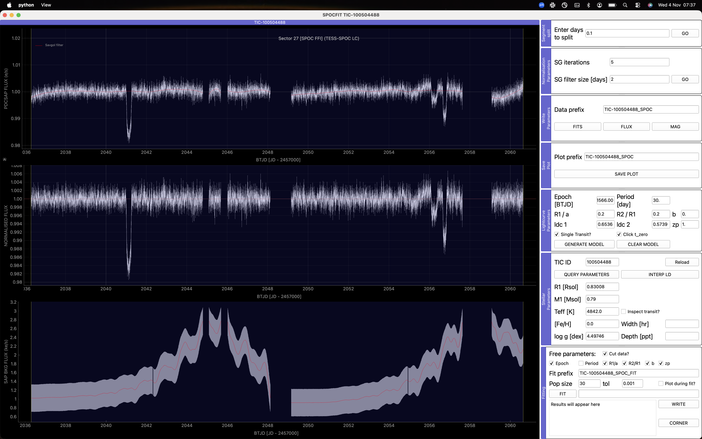

spocfit: inspect and fit SPOC photometry
========================================

``spocfit`` retrieves SPOC photometry for a TIC target and opens an interactive
workspace for inspecting the light curve, adjusting its normalisation,
generating transit models and fitting the data.

Launch the GUI
--------------

The syntax is ``spocfit TIC_ID [SECTOR]``; square brackets indicate an optional
argument, not characters to type. For TIC 100504488 in sector 27:

.. code-block:: bash

   spocfit 100504488 27

Omit the sector to load the target's available sectors:

.. code-block:: bash

   spocfit 100504488

   TIC 100504488 in the SPOCFIT GUI. The linked panels show the input
   PDCSAP flux, normalised flux and sky background; controls on the right
   adjust segmentation, detrending, transit parameters and fitting.
   Click the image to inspect the full-resolution screenshot.

An inspection and fitting workflow
----------------------------------

1. **Inspect the data.** Zoom into a candidate event and compare the input,
   normalised and background-flux panels. Background variations can help
   distinguish stellar variability from instrumental or scattered-light effects.
2. **Choose the segmentation.** Adjust **Enter days to split** and press **GO**
   to separate the light curve at gaps. This lets the trend estimation operate
   on individual segments.
3. **Adjust normalisation.** Set **SG iterations** and **SG filter size [days]**,
   then press **GO**. Compare the red trend with the data and check that the
   normalised transit is preserved. A filter window comparable to the transit
   duration can change the measured depth or shape.
4. **Generate a transit model.** Enter the epoch, period, ``R1/a``, ``R2/R1``,
   impact parameter, limb-darkening coefficients and flux zero point. Enable
   **Click t_zero** to choose an epoch from the input light curve, or enter it
   directly. **Single Transit?** restricts the model to one event.
   Press **GENERATE MODEL** to overlay the result.
5. **Fit selected parameters.** Choose the free-parameter checkboxes, configure
   the population size and tolerance, and press **FIT**. Use **Inspect transit?**
   to measure a region of interest and **Cut data?** when fitting only the
   selected transit region. Review the fitted model and results before export.

The GUI's epochs are displayed in **BTJD**, i.e. JD minus 2457000, as shown on
the axes. Enter an epoch in that same convention. These interactive fits are
useful for exploration and preparing a reproducible analysis; assess parameter
uncertainties and model assumptions separately for publication.

Export processed data
---------------------

Under **Write Parameters**, choose a **Data prefix** and use:

* **FITS** to save the working table, including the normalisation column.
* **FLUX** to save input and normalised flux as ``_FLUX.dat`` and
  ``_FLUX_NORMALISED.dat`` files, with times shifted back to full JD.
* **MAG** to save the corresponding magnitude files.

**SAVE PLOT** exports the displayed plots to PNG using the selected plot prefix.
The fitting panel's **WRITE** button saves the fit results under its fit prefix.
Keep the exported settings with the photometry when moving to a scripted fit
with :doc:`../examples/transit`.

Use photometry extracted with tesstpf
-------------------------------------

The **Fit the lightcurve** button in :doc:`tesstpf` exports the aperture
photometry and opens it directly in SPOCFIT. You can also open that working
file from the command line:

.. code-block:: bash

   spocfit TIC-100504488_S27_TPF_lightcurve.fits

The local-file mode expects the working table's TIME, SAP_FLUX, PDCSAP_FLUX,
PDCSAP_FLUX_ERR, SAP_BKG and SAP_BKG_ERR columns, plus TICID and SECTOR in the
primary FITS header. TIME remains in BTJD. The target identity is read from
that header; the TIC lookup supplies stellar information as usual.
