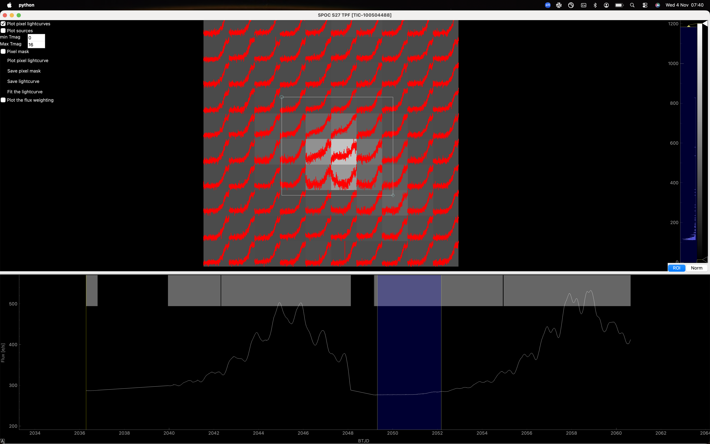

tesstpf: pixel-level and false-positive analysis
================================================

``tesstpf`` opens a TESS target-pixel view with per-pixel light curves, source
overlays, aperture editing and flux-weighted position diagnostics. It helps
check whether a photometric event originates at the target, a nearby source,
or a moving object such as an asteroid.

Example
-------

.. code-block:: bash

   tesstpf --tic_id 100504488 --sector 27

   Pixel-level inspection of TIC 100504488 in sector 27. The supplied
   screenshot shows per-pixel light curves across the image and a selected
   interval in the lower time-series panel. Click for the full-resolution image.

Locate the source of an event
-----------------------------

1. Enable **Plot pixel lightcurves** to compare the time dependence of individual
   pixels. Select an interval around the suspicious feature in the time-series
   panel and compare it with adjacent intervals.
2. Enable **Plot sources** to overlay catalogued sources; adjust **min Tmag**
   and **Max Tmag** to control which sources are shown. Check whether the
   affected pixels coincide with the target or a neighbouring star.
3. Enable **Plot the flux weighting** to inspect the flux-weighted positions
   for selected and comparison intervals. A position change can reveal that
   the changing flux is displaced from the intended target. This is an
   exploratory centroid diagnostic, not an automatic statistical validation.
4. Step through the pixel images around the event. An asteroid can produce a
   short brightening that moves across successive pixels rather than staying
   at a fixed stellar position. Compare the pixel light curves to trace this
   progression; identifying a particular asteroid needs an ephemeris cross-match.
5. Enable **Pixel mask** and click pixels to cycle their mask assignment:
   0 excludes a pixel, 1 selects sky and 2 selects target flux. Use
   **Plot pixel lightcurve** to inspect the resulting sky-subtracted aperture
   light curve. Select sky pixels when using this extraction.

Compare several apertures: a feature that disappears when a neighbouring
source or a moving object's path is excluded can indicate contamination.
Consider the source overlays, background and time dependence together when
assessing a possible false positive.

Save and reuse an aperture
--------------------------

**Save pixel mask** writes ``TIC-100504488_S27_pixel_mask.npy``.
Reload it on a subsequent run with:

.. code-block:: bash

   tesstpf --tic_id 100504488 --sector 27 --mask TIC-100504488_S27_pixel_mask.npy

**Save lightcurve** exports ``TIC-100504488_S27_TPF_lightcurve.fits`` in the
working directory. **Fit the lightcurve** exports a working FITS table and
opens it in :doc:`SPOCFIT <spocfit>`. Exported photometry can also be used in a
scripted :doc:`transit fit <../examples/transit>`.

Useful options
--------------

.. list-table::
   :header-rows: 1
   :widths: 30 70

   * - Option
     - Meaning
   * - ``--tic_id`` (``-e``)
     - Target TIC identifier.
   * - ``--sector`` (``-a``)
     - TESS sector to inspect.
   * - ``--size`` (``-b``)
     - Requested cutout size in pixels, default 10.
   * - ``--mask`` (``-c``)
     - Previously saved NumPy pixel-mask file.
   * - ``--coordinates`` (``-d``)
     - Coordinate values for a coordinate-based query.
   * - ``--all``
     - Request all available sectors rather than a single sector.
   * - ``--tica``
     - Select the TICA product path.
   * - ``--nogui``
     - Retrieve/export light-curve data without opening the pixel viewer.

Run ``tesstpf --help`` for the command's argument list.
