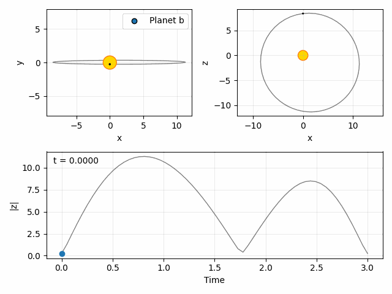

Visualise an orbit
==================

``bruce.visual.animate_orbit`` displays sky-plane and line-of-sight projections
and a separation trace. It accepts a list of planet dictionaries, so several
orbits can be drawn around the same star. Each orbit is an independent
Keplerian trajectory, not an N-body integration.

.. literalinclude:: orbit.py
   :language: python

:download:`Download the script <orbit.py>` or
:download:`download the GIF <../_static/orbit.gif>`.
Run the script with a GUI Matplotlib backend for an interactive window;
``MPLBACKEND=Agg python docs/examples/orbit.py`` saves the GIF without a window.
Pillow is required for GIF saving. Increase the number of time samples for a
smoother animation, or set ``zoom_primary=True`` to focus the sky view on the star.

Coordinates are scaled by the stellar radius. The lower trace is the sky-projected separation in stellar radii; despite
its current ``|z|`` label, it is not the line-of-sight distance.
The function calls ``plt.show()`` and returns ``None``.
See :doc:`../api/visual` for the dictionary keys and all options.
