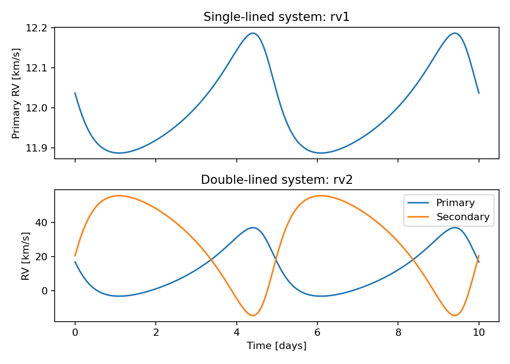

Radial velocities: rv1 and rv2
==============================

``rv1`` returns the primary-star velocity. ``rv2`` returns a tuple of arrays
``(primary_rv, secondary_rv)`` evaluated at the same times. Here velocities are
in km/s because the amplitudes and systemic velocity are in km/s. The two
panels show different amplitude choices, both with eccentricity 0.35.

.. literalinclude:: radial_velocity.py
   :language: python

:download:`Download the script <radial_velocity.py>`.

To fit single-lined data, pass both ``rv=observations`` and
``rv_err=uncertainties`` to ``rv1``. For double-lined data, pass all four arrays
``rv1``, ``rv1_err``, ``rv2``, ``rv2_err`` to ``rv2``. Both likelihood modes
return a scalar negative log likelihood, not a model tuple. All observation
arrays must share the time grid; handle missing secondary observations
explicitly. ``jitter`` uses the same velocity unit; the double-lined wrapper
uses one shared jitter. See :doc:`../api/binarystar`.
