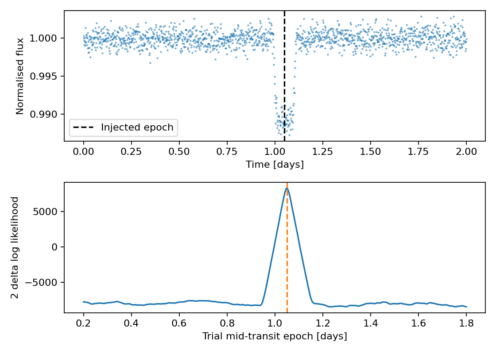

Detect a single transit with template matching
==============================================

This example injects a transit into a gently sloping baseline and searches
candidate epochs with a fixed transit shape. The supplied
``normalisation_model`` is the baseline **in the original flux units**, not
the flattened observations. BRUCE multiplies the transit model by this array.
The recovered epoch is the trial with the largest score.

.. literalinclude:: template_search.py
   :language: python

:download:`Download the script <template_search.py>`.

The score is ``2 * (logL_transit - logL_baseline)``. Positive values favour
the fixed template. It is not a posterior probability or a calibrated
false-alarm probability. The template's ``period`` sets its duration and
orbital geometry; this example searches epochs, not periods. ``ld_law=-2``
restricts the model to the event around each trial epoch.

The scalar-template search window uses the circular ``transit_width``
expression, even if an eccentric model is supplied. The batch path uses a
fixed window internally; use explicit trial epochs and validate coverage
before adopting either path for eccentric or multi-template searches.
A fitted baseline can absorb transits: protect events when detrending real
data. See :doc:`../api/template_match` for arguments and batch output layout.
