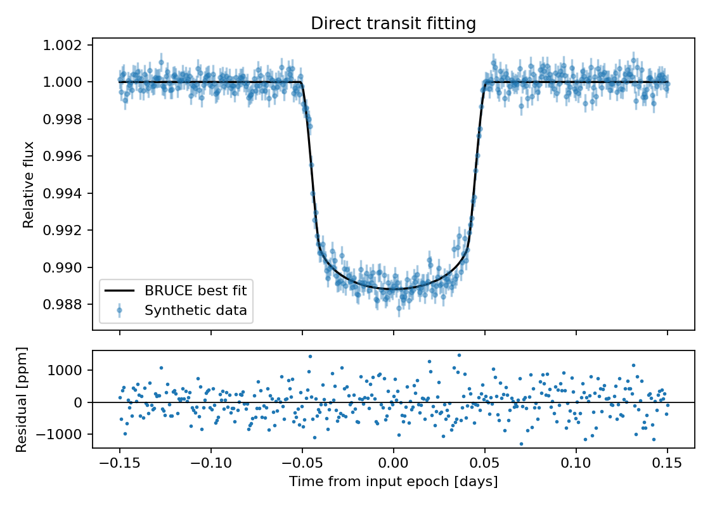

Transit modelling and direct fitting
====================================

``bruce.binarystar.lc`` evaluates a transit curve, or evaluates the negative log
likelihood directly in C when ``flux`` and ``flux_err`` are supplied.
This example simulates a circular, three-day planet with a two-minute exposure,
then fits its epoch and radius ratio. Other parameters are fixed deliberately;
a scientific fit should explore their uncertainty and degeneracies too.

.. literalinclude:: transit.py
   :language: python

Run ``python docs/examples/transit.py`` from the repository root.
:download:`Download the complete script <transit.py>`.
The optimiser result is a point estimate, not a posterior uncertainty.
For emcee, return ``log_prior - lc(..., flux=flux, flux_err=flux_err, offset=1)``.
See :doc:`../api/binarystar` for every argument.
